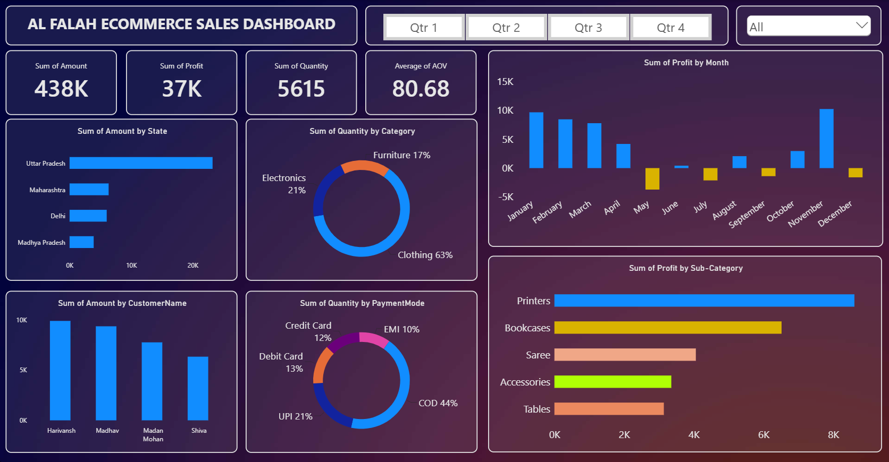

# 🛒 Al Falah E-Commerce Sales Dashboard (Power BI)

An interactive Power BI dashboard that analyzes e-commerce sales, profit, and customer behavior to help identify top-performing regions, categories, and payment trends.



---

## 📌 Project Overview

Al Falah is an e-commerce business selling Clothing, Electronics, and Furniture across multiple Indian states. The goal of this project was to turn raw transaction data into a clear, interactive dashboard that answers key business questions:

- How much revenue and profit is the business generating?
- Which states, categories, and sub-categories perform best?
- Which months are profitable, and which cause losses?
- How do customers prefer to pay?

---

## 📊 Key Metrics (KPIs)

| Metric | Value |
|---|---|
| Total Sales Amount | 438K |
| Total Profit | 37K |
| Total Quantity Sold | 5,615 |
| Average Order Value (AOV) | 80.68 |

---

## 🔍 Key Insights

- **Geography:** Uttar Pradesh is the top-performing state by sales amount, well ahead of Maharashtra, Delhi, and Madhya Pradesh.
- **Category:** Clothing dominates sales volume at 63%, followed by Electronics (21%) and Furniture (17%).
- **Payment Mode:** Cash on Delivery (COD) is the most popular at 44%, followed by UPI (21%), Debit Card (13%), Credit Card (12%), and EMI (10%).
- **Monthly Profit:** Profit was strong in January–April and November, but the business recorded losses in May, July, September, and December.
- **Sub-Category:** Printers generate the highest profit, followed by Bookcases, Saree, Accessories, and Tables.
- **Customers:** Top customers by sales amount are Harivansh, Madhav, Madan Mohan, and Shiva.

---

## 🧰 Tools & Skills Used

- **Power BI Desktop**
- **Power Query** – data cleaning and transformation
- **DAX** – calculated measures (Total Sales, Total Profit, Quantity, AOV)
- **Data Modeling** – connected the Orders and Details tables for analysis
- **Data Visualization** – KPI cards, bar charts, donut charts, slicers

---

## 🖥️ Dashboard Features

- KPI cards for Sales, Profit, Quantity, and AOV
- Quarter slicers (Qtr 1 – Qtr 4) for time-based filtering
- Sales by State and by Customer Name
- Quantity by Category and Payment Mode (donut charts)
- Profit trend by Month, with losses highlighted in a different color
- Profit by Sub-Category

---

## 📁 Repository Structure

```
├── AL-FALAH-ECOMMERCE-DASHBOARD.pbix   # Power BI dashboard file
├── README.md
├── LICENSE
├── data/
│   ├── Orders.csv
│   └── Details.csv
└── images/
    └── dashboard.png
```

---

## 🚀 How to Use

1. Clone or download this repository.
2. Open `AL-FALAH-ECOMMERCE-DASHBOARD.pbix` in **Power BI Desktop**.
3. If prompted, update the data source path to point to the files in the `data/` folder.
4. Use the quarter slicers and dropdown filter to explore the data.

---

## 📈 Business Recommendations

- Strengthen marketing and logistics in Uttar Pradesh while expanding in lower-performing states.
- Investigate the causes of losses in May, July, September, and December (discounts, returns, or costs).
- Promote UPI and prepaid options to reduce reliance on COD.
- Focus on high-profit sub-categories such as Printers and Bookcases.

---

## 👤 Author

**Shaikh Tauqeer**

- 📧 Email: [shaikhtauqeer1786@gmail.com](mailto:shaikhtauqeer1786@gmail.com)
- 🔗 LinkedIn: [linkedin.com/in/shaikhtauqeer](https://www.linkedin.com/in/shaikhtauqeer)
- 💻 GitHub: [github.com/Tauqeer1786](https://github.com/Tauqeer1786)

---

⭐ If you found this project useful, consider giving it a star!
